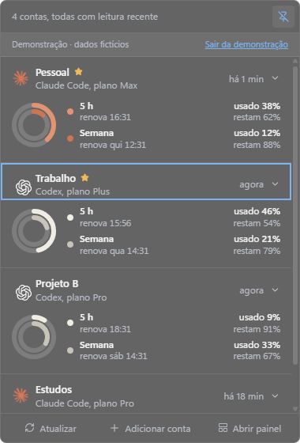

# UDV · Usage Dash View

**Suas contas de IA, de relance.**

Acompanhe quanto ainda pode usar no **Claude** e no **Codex**, e quando seus limites renovam. O UDV fica junto ao relógio do computador e reúne suas contas em um só lugar.

<p align="center">
  
  <br>
  <sub>Interface no Windows com dados fictícios do modo demonstração.</sub>
</p>

## O que você acompanha

- **Várias contas, uma visão:** contas pessoais e de trabalho de Claude e Codex no mesmo resumo.
- **Consumo e saldo:** anéis mostram o uso de cada janela, com percentuais restantes e horários de renovação ao lado.
- **Leituras automáticas:** saiba quando cada leitura foi feita e identifique dados antigos ou indisponíveis.
- **Contas organizadas:** dê nomes aos perfis, marque favoritos e use busca e filtros no painel.
- **Aparência do seu jeito:** tema claro, escuro ou do sistema, com opção de reduzir transparência.

Os perfis e preferências ficam no computador. Não há servidor UDV nem sincronização entre dispositivos; os CLIs se comunicam diretamente com seus provedores.

## Começar

Estamos preparando a **versão 0.1 para Windows e macOS**, com instaladores pelo GitHub Releases e download automático de atualizações. Veja o [plano da primeira versão](docs/atualizacoes.md) e o [changelog](CHANGELOG.md).

### Executar durante o desenvolvimento

Use **Node.js 22.12+**, npm e o **CLI nativo de Claude ou Codex**, conforme as contas que quiser conectar. No Windows, o executável do CLI precisa ser `.exe`; somente um wrapper `.cmd` não basta.

```sh
git clone https://github.com/gabcmelo/udv.git
cd udv
npm ci
npm run dev
```

O alvo da 0.1 é **Windows 11 22H2+** e **macOS 26+**. A integração macOS ainda precisa de build e validação em um Mac antes do lançamento.

Quer conhecer a interface primeiro? Selecione **Explorar com dados de exemplo**. A demonstração não exige login e não salva as contas fictícias como contas reais.

### Conectar suas contas

1. Abra **Adicionar conta**, escolha Claude ou Codex e dê um nome ao perfil.
2. Conclua o login: **Codex** abre o navegador; **Claude** abre um terminal para autenticação.
3. Repita para as outras contas. Cada perfil mantém seu login separado dos seus logins atuais nos CLIs.

Duas entradas conectadas à mesma assinatura compartilham a mesma cota. Criar outro perfil não cria um novo limite.

### No dia a dia

Clique no ícone da bandeja para abrir o resumo e em uma conta para ver os detalhes. Use **Fixar** para manter o resumo aberto ou **Abrir painel** para gerenciar as contas.

**Escape** fecha o resumo e desfaz a fixação. Um clique fora também fecha o resumo quando ele não está fixado. Fechar o painel mantém o app na bandeja; para encerrar, escolha **Sair do UDV** no menu do ícone.

## Como interpretar as leituras

| Provedor | Atualização | Observação |
| --- | --- | --- |
| Codex | A cada minuto | Consulta limites pelo app-server do CLI. |
| Claude | A cada 20 minutos | Consulta local de `/usage`, com leituras complementares da status line. |

No Claude, **Atualizar** pode antecipar uma consulta após um intervalo mínimo de um minuto. Se o provedor limitar as consultas, o app aguarda de 20 a 60 minutos antes de tentar novamente.

As janelas e os limites dependem do provedor, plano e versão do CLI. Uma leitura ausente ou expirada aparece como **—**, nunca como 0%. As cotas de janelas ou assinaturas diferentes são exibidas separadamente.

Nesta versão, o app ainda não oferece histórico, notificações ou inicialização automática.

## Atualizações do app

Em builds instalados, o UDV verifica novas versões ao iniciar e a cada seis horas. Atualizações publicadas são baixadas em segundo plano; você escolhe quando usar **Reiniciar e instalar**. **Depois** adia a instalação. Fechar o painel ou sair do app não instala a atualização automaticamente.

Use **Aparência e ajuda → Atualizações do UDV** ou **Verificar atualizações** no menu da bandeja para consultar manualmente. Durante o desenvolvimento, o atualizador fica desativado.

## Documentação

- [Versões, Releases e atualizações do app](docs/atualizacoes.md): funcionamento e critérios para fechar a 0.1.
- [Publicar uma versão](docs/lancamento.md): configuração dos certificados e pipeline de lançamento.
- [Desenvolvimento e distribuição](docs/desenvolvimento.md): comandos, estrutura do código e builds.
- [Dados e credenciais](docs/privacidade.md): armazenamento local, isolamento e remoção de contas.

---

UDV é um projeto independente, sem vínculo oficial com OpenAI ou Anthropic. Os nomes e ícones dos provedores identificam as integrações.
